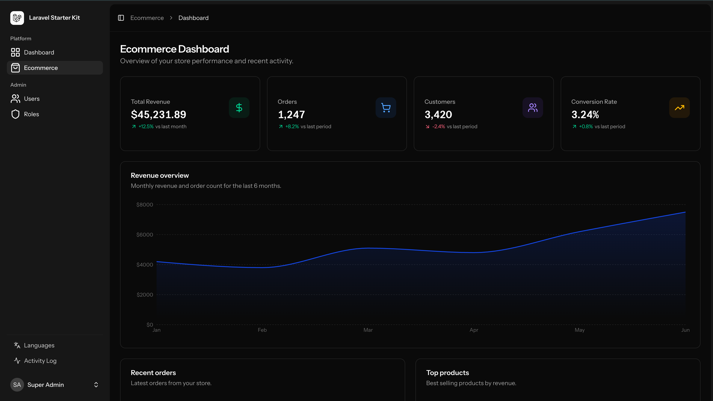

# Laravel Template

A Laravel 12 application with Inertia.js 2, React 19, and TypeScript. Includes authentication (Fortify), role/permission management, admin UI, and a sample ecommerce dashboard.



*Ecommerce dashboard — stats, revenue chart, recent orders, and top products.*

## Tech stack

- **Backend:** Laravel 12, PHP 8.2+
- **Frontend:** Inertia.js 2, React 19, TypeScript 5.7
- **Styling:** Tailwind CSS 4, Radix UI–based components (shadcn-style)
- **Auth:** Laravel Fortify (registration, login, 2FA, password reset)
- **Other:** Laravel Wayfinder (typed routes), Spatie (activity log, permissions, backup, media), Recharts (charts), Scribe (API docs)

## Requirements

- PHP 8.2+
- Composer
- Node.js 18+
- PostgreSQL (production) or SQLite (local)

## Installation

1. Clone the repository and install PHP dependencies:

   ```bash
   composer install
   ```

2. Copy environment file and generate key:

   ```bash
   cp .env.example .env
   php artisan key:generate
   ```

3. Configure `.env` (e.g. `DB_CONNECTION`, `DB_DATABASE` for SQLite or PostgreSQL).

4. Run migrations and seeders:

   ```bash
   php artisan migrate --seed
   ```

5. Install frontend dependencies and build:

   ```bash
   npm install
   npm run build
   ```

6. (Optional) Generate Wayfinder routes and API docs:

   ```bash
   php artisan wayfinder:generate
   php artisan scribe:generate
   ```

## Development

- **Start backend:** `php artisan serve`
- **Start Vite (frontend):** `npm run dev` (or use `composer run dev` if configured)
- **Run tests:** `php artisan test`
- **PHP code style:** `vendor/bin/pint`
- **Frontend lint/format:** `npm run lint`, `npm run format`, `npm run types`

## Features

- **Authentication:** Registration, login, email verification, password reset, two-factor authentication (Fortify).
- **Dashboard:** Summary widgets (user count, recent activity) at `/dashboard`.
- **Ecommerce dashboard:** Sample dashboard at `/ecommerce` with stats, revenue/orders charts (Recharts), recent orders, and top products (dummy data).
- **Admin (requires admin/super-admin role):** Users (CRUD, CSV import, bulk actions), Roles (CRUD, permissions), Activity log, Site settings, Languages & translations, Permissions. Access via sidebar when authorized.
- **Settings:** Profile, password, appearance, two-factor, site settings, permissions (under `/settings`).
- **API:** Documented with Scribe; permission checks and language endpoints available.

## Project structure

- `app/` — Laravel backend (controllers, models, actions, form requests).
- `resources/js/` — Frontend: `Pages/`, `layouts/`, `components/` (including `components/ui/` for shadcn-style components), `routes/` and `actions/` (Wayfinder-generated).
- `specs/` — Feature specs and tasks.
- `tests/` — PHPUnit feature and unit tests.

## Changelog

See [CHANGELOG.md](CHANGELOG.md) for version history and updates.
